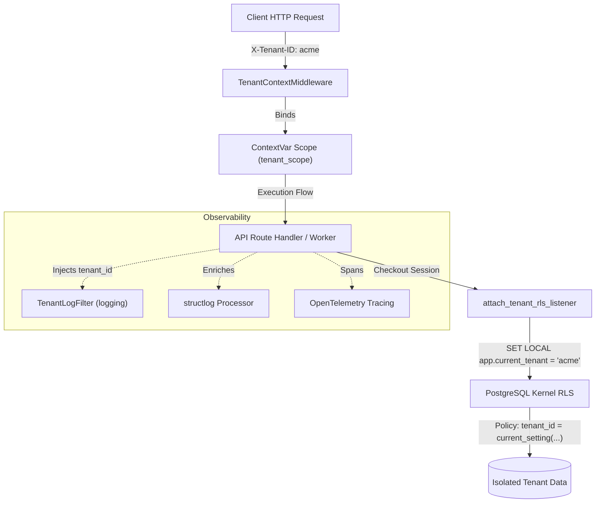

# 🛡️ tenant-context-isolation-kit

[](https://github.com/public-staging/tenant-context-isolation-kit/actions)
[](https://github.com/public-staging/tenant-context-isolation-kit/actions)
[](https://peps.python.org/pep-0561/)
[](https://www.python.org/downloads/)
[](https://opensource.org/licenses/MIT)

**Production-grade multi-tenant execution context, strict dependency injection, and zero-bleed isolation for modern Python runtimes.**

Designed for high-throughput asynchronous APIs (FastAPI/Starlette), background Celery workers, and multi-tenant database systems requiring defense-in-depth security.

---

## 🏗️ Architecture & Defense-in-Depth

The kit provides mathematical guarantees against **asynchronous context bleeding**, **connection pool poisoning**, and **cross-tenant data leakage**:



---

## 🎯 Key Architectural Primitives

| Primitive | Mechanism | SRE / Security Guarantee |
|---|---|---|
| **Immutable TenantContext** | Frozen dataclass + ContextVar scope | Eliminates implicit global state and `os.environ` mutations across concurrent worker jobs. |
| **ASGI Middleware** | `TenantContextMiddleware` | Automatic header parsing, tenant validation, and ContextVar scoping with zero coroutine bleed. |
| **PostgreSQL RLS Hooks** | `SET LOCAL app.current_tenant` | Database kernel level isolation; queries cannot return other tenants' rows even with `SELECT *`. |
| **Observability Telemetry** | `TenantLogFilter`, structlog processor | Automatic injection of `tenant_id` and `workspace_id` into all application logs and trace spans. |
| **Zero-Bleed Fuzzing** | 1,000 tasks / 50 tenants stress test | Empirically verified zero ContextVar leakage across `asyncio.gather` and `ThreadPoolExecutor`. |
| **Redis Quota Protection** | All-tenant batch cache warming | Eliminates Google Sheets API HTTP 429 `RESOURCE_EXHAUSTED` spikes on worker startup. |
| **Isolated Client Registry** | Fresh factory instantiation & thread-local caching | Guarantees zero cross-tenant credential bleed with automatic child process clearing on `os.fork()`. |
| **Constant-Time Verification** | `secrets.compare_digest` | Protects tenant tokens against side-channel timing attacks. |

---

## 🚀 Quickstart

### 1. ASGI Middleware (FastAPI / Starlette)

```python
from fastapi import FastAPI
from tenant_context_isolation_kit import TenantContextMiddleware, get_current_tenant

app = FastAPI()
app.add_middleware(
    TenantContextMiddleware,
    tenant_header="x-tenant-id",
    enforce_tenant=True,
)

@app.get("/items")
def list_items():
    current = get_current_tenant()
    return {"tenant": current.tenant_id, "workspace": current.workspace_id}
```

### 2. PostgreSQL Row-Level Security (RLS) Hook

```python
from tenant_context_isolation_kit import attach_tenant_rls_listener

def get_db():
    db = SessionLocal()
    try:
        # Executes SET LOCAL app.current_tenant = :tenant_id
        attach_tenant_rls_listener(db.connection(), is_local=True)
        yield db
        db.commit()
    finally:
        db.close()
```

### 3. Structured Logging & Observability

```python
import logging
from tenant_context_isolation_kit import TenantLogFilter

handler = logging.StreamHandler()
handler.addFilter(TenantLogFilter())
handler.setFormatter(logging.Formatter("[%(asctime)s] [%(tenant_id)s] %(message)s"))

logger = logging.getLogger("app")
logger.addHandler(handler)
# Output: [2026-10-22 20:30:00] [acme-corp] Processing incoming order
```

---

## 🛡️ Exception Hierarchy

All library exceptions inherit from `TenantIsolationError` for clean API boundary error handling:

* `TenantIsolationError`: Root exception for all isolation kit errors.
  * `MissingTenantContextError`: Operation attempted without required tenant scope.
  * `CrossTenantAccessError`: Unauthorized attempt to cross tenant boundaries.
  * `TenantQuotaExceededError`: Tenant exceeded defined throughput or rate quotas.
  * `TenantConfigurationError`: Malformed or invalid tenant registry configuration.

---

## 📂 Reference Architecture & Examples

A complete, runnable **FastAPI + PostgreSQL RLS + Docker Compose** demonstration stack is located in [`examples/fastapi-postgres-rls/`](examples/fastapi-postgres-rls/).

Spin it up with:
```bash
cd examples/fastapi-postgres-rls
docker compose up -d
```

### 🐳 Container Architecture: Library vs. Demo Stack

* **Root `Dockerfile` & `docker-compose.yml`:** Minimal, hardened CI test sandbox used exclusively for containerized security scans (`make audit` via Trivy) and clean-room testing. This is not an application service.
* **`examples/fastapi-postgres-rls/`:** Dedicated, standalone multi-tenant application demo with its own `Dockerfile`, `docker-compose.yml`, and PostgreSQL RLS policies.

---

## 🏛️ Architecture Decision Records (ADRs)

* [ADR 001: ContextVars vs. ThreadLocal for Multi-Tenant Scoping](docs/adr/001-contextvars-vs-threadlocal.md)
* [ADR 002: Fail-Closed Cascading Routing and Batch Cache Warming](docs/adr/002-fail-closed-routing-strategy.md)
* [ADR 003: PostgreSQL Row-Level Security Connection Scoping](docs/adr/003-postgresql-rls-connection-scoping.md)

---

## 🧪 Testing & Verification

```bash
# Run complete test suite (including 1000-task anti-bleed concurrency stress test)
pytest tests/ -v

# Run Bandit security static AST analysis
bandit -r src/ -ll

# Run clean-room blacklist verification
make check-blacklist
```

---

## 🔒 Security Policy

Please review [SECURITY.md](SECURITY.md) for our vulnerability disclosure policy and full threat model.
